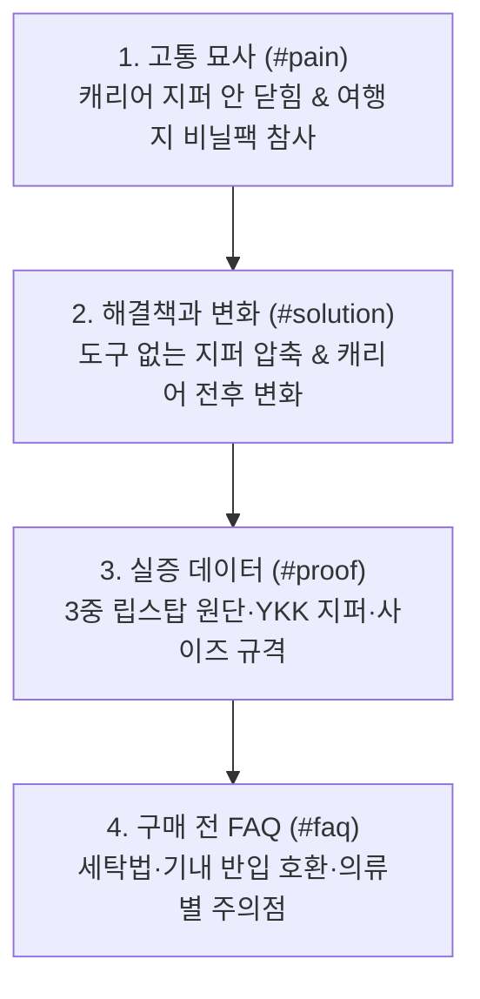
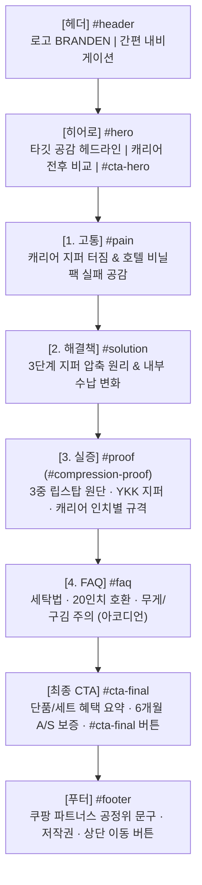

# 브랜든 2세대 여행용 부피순삭 압축 파우치 랜딩 페이지 설계도

> **버전**: 최종 기획 완성본 (헤더 · 히어로 · 디테일 · CTA · 푸터 · UI 인터랙션 · 이미지 크롭 명세)
> 
> **페이지 목적**: 3박 4일 이상 겨울·간절기 여행 준비 중 캐리어가 두꺼운 옷으로 가득 차는 고객에게 제품의 구체적인 해결 원리와 실증 결과를 보여주고, 최종 쿠팡 구매 페이지로 연결한다.
>
> **기술 스택 및 구현 기준**: 순수 HTML5, CSS3 (Vanilla CSS), JavaScript (Vanilla JS)로 구현. 별도의 백엔드 서버, 회원가입, 결제 모듈 없이 동작하며 반응형 웹(Mobile / Desktop)을 지원한다.

---

## 1. 페이지 기준

### 목적·ID

- 전체 페이지 컨테이너 ID: `#landing`
- 상품명: **브랜든 2세대 여행용 부피순삭 압축 파우치**
- 전환 목표: 제품이 꼭 필요한 타깃 고객이 상세 스펙과 실증 데이터를 확인한 뒤, 쿠팡 제휴 구매 CTA를 통해 구매 페이지로 이동한다.
- 핵심 고객 상황: 3박 4일 이상 겨울·간절기 여행을 준비하며, 두꺼운 니트·패딩 몇 벌 때문에 캐리어 뚜껑을 온몸으로 억지로 눌러 닫는 보부상형 여행자.
- 핵심 이득: 청소기나 핸드펌프 없이 외곽 압축 지퍼를 잠그는 물리적 방식으로, 공기층이 많은 니트·패딩의 부피를 낮추고 단단히 각을 잡아 캐리어 공간 여유를 확보한다.

### 실제 문구

- 상단 헤더 브랜드 표기: `BRANDEN` (또는 영문 로고)
- 페이지 상단 보조 표기: `겨울여행 짐을 덜 부풀게 담는 방법`
- 공식 제품 등록명: `브랜든 2세대 여행용 부피순삭 압축 파우치`

### PC·모바일 배치 및 읽는 순서

- PC와 모바일 모두 첫 진입 시 **헤더(#header) → 히어로(#hero: 고객 불편 → 결과 제시 → 작동 단서)**가 가장 먼저 노출된다.
- 본문 영역은 심리적 설득 4단계인 **1) 고통 묘사(#pain) → 2) 해결책과 변화(#solution) → 3) 증거(#proof) → 4) 구매 전 걱정 해소(#faq)** 순서로 읽히도록 전개한다.
- 전환 접점은 **히어로 상단 CTA(#cta-hero)**와 **페이지 최하단 최종 CTA(#cta-final)** 두 곳에 전략적으로 배치하며, 하단에 신뢰 보장을 위한 **푸터(#footer)**를 둔다.

### 이미지 경로·사용 범위

- 페이지 전반의 이미지 원본 경로: `part2-landing-page/assets/`
- 원본 상세페이지 이미지는 필요한 핵심 정보만 명확히 전달될 수 있도록 `(x, y, width, height)` 좌표 영역을 지정하여 부분 크롭 방식으로 사용한다.
- 아직 준비되지 않은 이미지나 외부 자료는 임의로 파일명을 지정하지 않고 `[이미지 준비 중]` 플레이스홀더로 명시한다.

### UI와 동작

- 상단 도착 시 URL의 `#landing`을 기준으로 첫 화면을 렌더링한다.
- 네비게이션 및 히어로 스크롤 버튼 클릭 시 타깃 섹션으로 부드러운 스크롤(Smooth Scroll) 이동을 지원한다.
- FAQ 영역은 모바일 화면 높이를 고려해 기본 닫힘 상태(첫 번째 질문만 기본 펼침 권장)의 아코디언 인터랙션을 제공한다.
- 현재 프로토타입 단계에서 CTA 버튼 클릭 시 브라우저 내 커스텀 모달 알림(예: `"쿠팡 파트너스 구매 링크 연결 준비 중입니다."`)을 띄우며, 향후 실습 3에서 실제 쿠팡 파트너스 트래킹 URL로 전환한다.

### 기획 메모 — 근거와 표현 범위

| 구분 | 기획에 반영한 내용 | 근거 자료 출처 |
| --- | --- | --- |
| 확인된 사실 | 도구(청소기·펌프) 없이 외곽 압축 지퍼 체결로 부피 축소, 210D 립스탑 나일론 3중 레이어 원단, YKK 지퍼, M사이즈 양면 분리 구조 | [05-product-evidence.md](file:///c:/Users/121/Documents/antigravity/beautiful-salk/Digital%20Marketing/part1-product-selection/05-product-evidence.md#12-핵심-사양-및-스펙), `assets/product1-detail-content15.png`, `content16.png` |
| 타깃 가설 | 3박 4일 이상 겨울·간절기 여행에서 캐리어 용량 부족에 시달리는 보부상형 여행자 | [06-3c-analysis.md](file:///c:/Users/121/Documents/antigravity/beautiful-salk/Digital%20Marketing/part1-product-selection/06-3c-analysis.md#customer-고객-관점) |
| 과장 배제 | "모든 옷이 절반으로 줄어든다", "무게가 가벼워진다" 등 허위·과장 문구 배제 | [05-product-evidence.md](file:///c:/Users/121/Documents/antigravity/beautiful-salk/Digital%20Marketing/part1-product-selection/05-product-evidence.md#c-아쉬운-점--주의사항-핵심-요약) (무게 불변 및 공기층 없는 의류 한계 명시) |
| 솔직한 사용 조건 | 파우치 용적의 80~90%만 수납 권장, 청바지/가죽류는 효과 미미, 셔츠/실크류 구김 주의 안내 | [05-product-evidence.md](file:///c:/Users/121/Documents/antigravity/beautiful-salk/Digital%20Marketing/part1-product-selection/05-product-evidence.md#13-판매자가-설명하는-장점과-주의사항), `assets/product1-detail-content16.png` |

---

## 2. 히어로 (Hero Section)

### 목적·ID

- 섹션 ID: `#hero`
- 목적: 고객이 자신의 여행 짐 싸기 스트레스 장면을 즉시 떠올리게 하고, 압축 전·후 결과를 직관적으로 제시한 뒤 "지퍼만으로 어떻게 달라지는지"를 확인하도록 상세 설득 흐름으로 유도한다.

### 실제 문구

| 구분 | 확정 문구 |
| --- | --- |
| 타깃 호출 | **두꺼운 니트와 패딩 몇 벌에, 캐리어 뚜껑을 또 온몸으로 누르고 계셨나요?** |
| 헤드라인 | **부푼 겨울옷 부피는 낮추고, 캐리어엔 여유를 남기세요.** |
| 서브카피 | 청소기나 펌프 없이, 옷을 넣고 압축 지퍼를 돌려 닫는 방식. 공기층이 많은 니트와 패딩을 가방 안에 더 낮고 단정하게 정리해 줍니다. |
| 적합성 안내 | ※ 공기층이 풍부한 니트·패딩·경량 아우터에 특히 효과적입니다. |
| 방식 단서 | 차곡차곡 넣고, 지그시 누르며, 지퍼를 닫습니다. |
| 스크롤 UI | **캐리어 속이 어떻게 달라질까요? 변화 확인하기 ↓** |

### PC·모바일 배치

| 화면 | 배치 순서 |
| --- | --- |
| PC | **좌측**: 1) 타깃 호출 → 2) 헤드라인 → 3) 서브카피 & 적합성 안내 → 4) **히어로 CTA (#cta-hero)** → 5) 스크롤 UI.<br>**우측**: 캐리어 압축 전·후 실사 비교(`content14.png`)를 메인으로 두고, 우하단에 지퍼 닫는 손 동작 컷(`content13.png`)과 파우치 외형 컷(`image1.png`)을 자연스럽게 오버랩 배치. |
| 모바일 | 1) 타깃 호출 → 2) 헤드라인 → 3) 압축 전·후 비교 이미지(`content14.png`) → 4) 서브카피 & 적합성 안내 → 5) 지퍼 동작 이미지(`content13.png`)와 방식 단서 → 6) **히어로 CTA (#cta-hero)** → 7) 스크롤 UI. |

### 이미지 경로·사용 범위·대체 텍스트

| 역할 | 실제 경로 | 보여줄 영역 (Crop / Resolution) | 대체 텍스트 |
| --- | --- | --- | --- |
| 히어로 결과 증거 | `part2-landing-page/assets/product1-detail-content14.png` | 원본 1000 × 2151px 중 **캐리어 비교 영역** (`x: 0, y: 630, width: 1000, height: 810`) | `압축 전 옷이 넘치는 캐리어와 압축 후 브랜든 파우치로 정돈된 캐리어 비교` |
| 히어로 작동 단서 | `part2-landing-page/assets/product1-detail-content13.png` | 1000 × 1000px 전체 사용 | `손으로 파우치 중앙을 누르며 외곽 압축 지퍼를 닫는 사용 모습` |
| 제품 형태 컷 | `part2-landing-page/assets/product1-image1.png` | 492 × 492px 전체 사용 | `브랜든 부피순삭 압축 파우치 라이트 베이지 외형` |

### UI와 동작

- 스크롤 UI 버튼 클릭 시 `#pain` 섹션으로 부드럽게 스크롤(Smooth Scroll) 이동한다.
- 앵커 타깃: `#pain`

---

## 3. 디테일 (상세 설득 흐름)

설득 흐름은 고객 심리 변화에 맞춰 **1) 고통 묘사(Pain) → 2) 해결책과 변화(Solution) → 3) 증거(Proof) → 4) 구매 전 걱정(FAQ)**의 4단계로 구성한다.



---

### 3.1 고통 묘사 (Pain Section)

#### 목적·ID
- 섹션 ID: `#pain`
- 목적: 3박 4일 이상 여행을 앞두고 짐을 쌀 때 누구나 겪어본 구체적인 행동(무릎 꿇고 캐리어 누르기)과 여행지에서의 불안(비닐팩 바람 빠짐, 옷 섞임)을 생생하게 묘사하여 깊은 공감을 유도한다.

#### 실제 문구

| 구성 항목 | 고객에게 보여줄 실제 문구 |
| :--- | :--- |
| **섹션 소제목** | TRAVEL PAIN POINT |
| **섹션 메인 타이틀** | **"분명 옷 몇 벌 안 넣었는데... 왜 캐리어는 터지려고 할까요?"** |
| **공감 리드문** | 여행 전날 밤, 닫히지 않는 캐리어 뚜껑 위에 무릎을 꿇고 앉아 땀을 뻘뻘 흘렸던 경험, 한 번쯤 있으시죠? |
| **상황 카드 1** | **[출발 전] 무릎으로 누르다 지퍼가 터질 뻔한 순간**<br>겨울 니트 두 벌, 외투 하나 넣었을 뿐인데 불룩 솟아오른 짐. 억지로 지퍼를 당기다 캐리어 레일이 뜯어질까 조마조마했던 답답함. |
| **상황 카드 2** | **[여행지에서] 청소기가 없어 다시 못 쓰는 비닐 압축팩**<br>집에서는 청소기로 바짝 줄였는데, 돌아오는 호텔 방엔 청소기가 없습니다. 손으로 말아도 금세 공기가 차오르고 찢어지는 일회용 비닐팩의 배신. |
| **상황 카드 3** | **[귀국길] 쇼핑 기념품을 넣을 자리가 없는 난감함**<br>입었던 빨랫감은 부풀어 오르고, 현지에서 산 과자와 선물은 들어갈 틈이 없어 결국 공항에서 쇼핑백을 주렁주렁 들고 다녀야 했던 피로감. |

#### PC·모바일 배치
- **PC**: 상단에 헤드라인과 리드문을 배치하고, 하단에 3개의 상황 카드를 3열 그리드로 나란히 배치하여 한눈에 고객 문제를 확인하게 한다.
- **모바일**: 상단 헤드라인 아래 3장의 카드를 세로 1열 카드 스택(Card Stack) 형태로 순차 배치하여 스크롤하며 몰입하도록 구성한다.

#### 이미지 경로·사용 범위·대체 텍스트
- **배치 이미지**: `part2-landing-page/assets/product1-detail-content14.png`
  - **사용 영역**: 원본 1000 × 2151px 중 **압축 전 어질러진 옷더미 캐리어 좌측 단독 영역** (`x: 0, y: 700, width: 500, height: 700`)
  - **대체 텍스트**: `캐리어 안에서 부풀어 올라 뚜껑이 닫히지 않는 어지러운 옷가지들`
  - **기획 메모**: 고객의 현재 문제 상태를 시각적으로 보여주는 용도로 크롭하여 배치.

#### 기획 메모 및 출처
- 출처: [05-product-evidence.md](file:///c:/Users/121/Documents/antigravity/beautiful-salk/Digital%20Marketing/part1-product-selection/05-product-evidence.md#a-고객이-사용한-구체적-상황) A섹션(상황 1, 2) 및 실사용자 불만 후기 C-1, C-2 반영.

---

### 3.2 해결책과 변화 (Solution Section)

#### 목적·ID
- 섹션 ID: `#solution`
- 목적: 앞서 짚은 문제를 완전히 뒤집어, 청소기 없이 외곽 압축 지퍼만으로 부피가 줄어드는 원리와 전후의 시각적 변화를 명쾌하게 제시한다.

#### 실제 문구

| 구성 항목 | 고객에게 보여줄 실제 문구 |
| :--- | :--- |
| **섹션 소제목** | THE SIMPLE SOLUTION |
| **섹션 메인 타이틀** | **청소기도, 펌프도 필요 없습니다.<br>옷을 넣고 지퍼만 잠그면 부피가 쏙 줄어듭니다.** |
| **핵심 변화 설명** | 공기층을 머금은 겨울 니트와 패딩을 차곡차곡 넣고 외곽 지퍼를 한 바퀴 돌려주세요. 물리적 이중 압축 구조가 옷감 사이의 불필요한 공기를 빠져나가게 만들어 가방 속 공간을 확보해 줍니다. |
| **3단계 작동 원리** | **STEP 1. 수납**: 파우치에 의류를 평평하게 80~90% 채웁니다.<br>**STEP 2. 밀폐**: 상단 메인 지퍼를 닫아 내용물이 튀어나오지 않게 밀봉합니다.<br>**STEP 3. 압축**: 손으로 중앙을 가볍게 누르며 외곽 360도 압축 지퍼를 돌려 잠급니다. |
| **변화 포인트 1** | **[공간 확보]** 불룩했던 캐리어 한 칸이 반듯한 블록 형태로 정리되어 쇼핑 기념품 자리가 생깁니다. |
| **변화 포인트 2** | **[흐트러짐 방지]** 압축 후 단단하게 각이 잡혀, 이동 중 가방을 굴려도 내부 짐이 쏟아지거나 쏠리지 않습니다. |
| **변화 포인트 3** | **[분리 수납]** 2세대 M사이즈는 양면 2실 구조로 새 옷과 입은 세탁물을 한 파우치에서 위생적으로 나눕니다. |

#### PC·모바일 배치
- **PC**: 좌측에 3단계 사용 가이드 및 핵심 변화 텍스트를 배치하고, 우측에 단계별 실제 동작 컷(`content10.png` 수납 → `content13.png` 지퍼 압축 → `content3.png` 전후 비교)을 시각적으로 연결.
- **모바일**: 헤드라인 → 3단계 사용 과정 이미지 & 설명 카드 → 전후 비교 컷(`content3.png`) 순으로 세로로 배치.

#### 이미지 경로·사용 범위·대체 텍스트
| 역할 | 실제 경로 | 보여줄 영역 (Crop / Resolution) | 대체 텍스트 |
| --- | --- | --- | --- |
| 1단계 의류 수납 | `part2-landing-page/assets/product1-detail-content10.png` | 1000 × 680px 전체 사용 | `파우치를 열고 니트와 의류를 차곡차곡 평평하게 넣는 모습` |
| 2단계 지퍼 체결 | `part2-landing-page/assets/product1-detail-content13.png` | 1000 × 1000px 전체 사용 | `파우치 중앙을 손으로 누르며 외곽 지퍼를 부드럽게 닫는 모습` |
| 지퍼 압축 전후 다이어그램 | `part2-landing-page/assets/product1-detail-content3.png` | 원본 1000 × 8885px 중 **최하단 지퍼 압축 3단계 영역** (`x: 0, y: 7700, width: 1000, height: 1185`) | `옷을 쌓아 올린 상태에서 파우치 수납 후 최종 압축된 높이 변화 다이어그램` |

#### 기획 메모 및 출처
- 출처: `assets/product1-detail-content3.png`의 "진공팩 없이 간편하게 넣고 지퍼만 잠그면 압축 끝" 다이어그램 팩트 및 [05-product-evidence.md](file:///c:/Users/121/Documents/antigravity/beautiful-salk/Digital%20Marketing/part1-product-selection/05-product-evidence.md#12-핵심-사양-및-스펙) 1.2 사용 방법 기반.

---

### 3.3 증거 (Proof Section)

#### 목적·ID
- 섹션 ID: `#proof` (또는 히어로 링크 대상인 `#compression-proof`)
- 목적: "과연 찢어지지 않을까?", "지퍼가 터지지 않을까?"라는 고객의 핵심 불안을 물리적 원단 스펙(210D 립스탑, YKK 지퍼, 내장재)과 실제 캐리어 수납 모듈 규격으로 입증한다.

#### 실제 문구

| 구성 항목 | 고객에게 보여줄 실제 문구 |
| :--- | :--- |
| **섹션 소제목** | PROVEN QUALITY |
| **섹션 메인 타이틀** | **한 번 사서 오래 쓰는 비결,<br>원단부터 지퍼까지 타협하지 않았습니다.** |
| **근거 1: 원단 내구성** | **[210D 립스탑 나일론 3중 레이어]**<br>낙하산이나 고기능성 텐트에 쓰이는 격자 직조 립스탑 원단을 사용했습니다. 겉감(210D 나일론), 무너짐 방지 완충 내장재(폴리에틸렌 폼), 안감(폴리에스터)의 3중 구조로 강한 압축 장력에도 찢어짐 없이 팽팽하게 버텨줍니다. |
| **근거 2: 지퍼 체결력** | **[정품 YKK 지퍼 & 안감 보호 가드]**<br>압축 파우치의 생명은 지퍼입니다. 세계적으로 검증된 고강도 YKK 지퍼를 장착하여 레일 벌어짐을 방지하고, 지퍼 안쪽에 보호 천을 덧대어 닫을 때 얇은 옷감이 씹히는 현상을 막아줍니다. |
| **근거 3: 캐리어 규격 최적화** | **[20인치부터 28인치까지 빈틈없는 모듈 수납]**<br>기내용 캐리어(20인치: S+S+M 구성)부터 대형 수화물(24인치: S+S+M+L 구성, 28인치: S+S+M+M+L 구성)까지 테트리스 블록처럼 반듯하게 맞아떨어집니다. |
| **사이즈별 상세 스펙** | • **S (30×20cm)**: 압축 전 높이 18.5cm → 압축 후 9.5cm (양말, 속옷, 얇은 상의)<br>• **M (35×25cm)**: 압축 전 높이 22.5cm → 압축 후 13.5cm (셔츠, 니트, 하의 양면 분리 수납)<br>• **L (40×30cm)**: 압축 전 높이 23.5cm → 압축 후 13.5cm (겨울 외투, 패딩, 두꺼운 스웨터) |
| **실구매자 검증 후기 요약** | • "유럽 2주 여행 때 겨울 니트 6벌을 넣고 지퍼 잠그니 캐리어 반쪽이 텅 비었습니다." (실구매 후기)<br>• "저가형 쓰다 지퍼 터져서 버렸는데, 브랜든은 3년째 멀쩡하게 해외 출장 다닙니다." (실구매 후기)<br>• "압축 후 단단하게 각이 잡혀서 캐리어 안에서 짐이 쏠리지 않는 게 최고 장점이에요." (실구매 후기) |

#### PC·모바일 배치
- **PC**: 
  - 상단: 원단 3중 구조 설명 및 원단/지퍼 접사 컷(`content15.png` 크롭, `image2.png`).
  - 중단: 캐리어 인치별 수납 조합표(`content4.png` 크롭)와 S/M/L 규격 비교.
  - 하단: 실구매자 핵심 후기 3개 카드 가로 배치.
- **모바일**: 
  - 3중 레이어 원단 그래픽 → 지퍼 가드 설명 → 캐리어 인치별 패킹 안내 → 규격표 → 실구매자 후기 카드 순서로 스크롤 전개.

#### 이미지 경로·사용 범위·대체 텍스트
| 역할 | 실제 경로 | 보여줄 영역 (Crop / Resolution) | 대체 텍스트 |
| --- | --- | --- | --- |
| 3-Layer 원단 구조 | `part2-landing-page/assets/product1-detail-content15.png` | 원본 1000 × 5674px 중 **3-LAYER 원단 다이어그램 영역** (`x: 0, y: 1530, width: 1000, height: 600`) | `겉감 210D 나일론, 내장재 폴리에틸렌 폼, 안감 폴리에스터 3중 레이어 원단 구조도` |
| YKK 지퍼 및 가드 디테일 | `part2-landing-page/assets/product1-image2.png` | 492 × 492px 전체 사용 | `손가락 고리와 스트링이 달린 견고한 YKK 정품 압축 지퍼 상세 컷` |
| 생활 발수 성능 | `part2-landing-page/assets/product1-image4.png` | 492 × 492px 전체 사용 | `원단 표면에 물방울이 스며들지 않고 맺혀 있는 생활 발수 코팅 컷` |
| 캐리어 인치별 수납 가이드 | `part2-landing-page/assets/product1-detail-content4.png` | 원본 1000 × 4700px 중 **20/24/28인치 캐리어별 큐레이션 영역** (`x: 0, y: 880, width: 1000, height: 2150`) | `20인치, 24인치, 28인치 캐리어에 들어가는 S, M, L 파우치 배치 조합 안내` |
| S/M/L 사이즈 상세 도면 | `part2-landing-page/assets/product1-detail-content16.png` | 원본 1000 × 7610px 중 **사이즈 입체 도면 영역** (`x: 0, y: 480, width: 1000, height: 1650`) | `S, M, L 사이즈별 가로, 세로, 압축 전/후 높이 치수 다이어그램` |

#### 기획 메모 및 출처
- 출처: `assets/product1-detail-content15.png`, `content16.png` 공식 스펙표 및 [05-product-evidence.md](file:///c:/Users/121/Documents/antigravity/beautiful-salk/Digital%20Marketing/part1-product-selection/05-product-evidence.md#b-만족한-내용-핵심-요약) 만족 후기 #1, #11, #17 팩트 인용.

---

### 3.4 구매 전 걱정 (FAQ Section)

#### 목적·ID
- 섹션 ID: `#faq`
- 목적: 구매 직전 고객이 가장 망설이는 핵심 불안(세탁 관리법, 캐리어 호환성 및 과충전 주의, 의류별 압축 효과와 무게 한계) 3가지를 명확히 해소하여 구매 결정을 돕는다.

#### 실제 문구 (엄선된 핵심 질문 3개)

| 번호 | 질문 (Q) | 공식 답변 및 솔직한 가이드 (A) |
| :---: | :--- | :--- |
| **Q1** | **세탁기나 건조기에 넣고 돌려도 되나요?** | **권장하지 않습니다.** 생활 발수 코팅과 내부 완충 폼, 지퍼 레일의 수명을 위해 **세탁기·건조기 사용 및 고열 다림질은 피해 주세요.**<br>오염이 묻었을 때는 마른 천이나 물티슈에 중성세제를 살짝 묻혀 가볍게 닦아내 주시고, 심한 오염일 경우에만 찬물에 가볍게 단독 손세탁한 뒤 그늘에서 자연 건조해 주시면 오래 사용하실 수 있습니다. |
| **Q2** | **기내용 20인치 캐리어에도 쏙 들어가나요?** | **네, S와 M 사이즈 조합으로 완벽하게 들어맞습니다.**<br>20인치 기내용 캐리어에는 `S 2개 + M 1개` 구성이 알맞게 수납됩니다. 다만, **XL 사이즈 이상의 대형 파우치는 20인치 캐리어에 들어가지 않으므로** 패딩이나 두꺼운 짐을 담으실 때는 본인의 캐리어 인치 규격(24인치 이상 권장)을 꼭 확인해 주세요. |
| **Q3** | **압축하면 캐리어 무게도 가벼워지나요? 모든 옷에 효과가 있나요?** | **부피(두께)는 확실히 줄어들지만, 의류 자체의 무게는 줄어들지 않습니다.**<br>따라서 저비용항공사(LCC) 이용 시 수화물 무게 제한(보통 15kg)을 넘기지 않도록 유의해 주세요.<br>또한 패딩·니트·플리스처럼 **공기층이 많은 의류는 드라마틱하게 줄어들지만**, 청바지나 가죽처럼 조직이 치밀한 의류는 부피 감소 체감이 적을 수 있습니다. 정장 셔츠나 실크는 강한 압축 시 구김이 생길 수 있으니 가볍게 수납하시는 것을 추천합니다. |

#### PC·모바일 배치
- **PC**: 질문과 답변이 깔끔하게 정돈된 세로형 아코디언 목록으로 중앙(최대 너비 800px) 배치.
- **모바일**: 상하 여백을 충분히 준 아코디언 탭 UI 적용. 탭 터치 시 부드럽게 펼쳐지며 닫히는 토글 인터랙션 제공.

#### 이미지 경로·사용 범위·대체 텍스트
- **배치 이미지**: `part2-landing-page/assets/product1-detail-content16.png`
  - **사용 영역**: 원본 1000 × 7610px 중 **FAQ 상단 영역** (`x: 0, y: 3450, width: 1000, height: 1400`)
  - **대체 텍스트**: `브랜든 공식 세탁 주의사항 및 제품 상세 가이드 안내 영역`
  - **기획 메모**: 공식 상세페이지의 FAQ 섹션을 근거로 작성되었음을 증명하는 보조 그래픽으로 활용.

#### 기획 메모 및 출처
- 출처: `assets/product1-detail-content16.png`의 공식 FAQ 및 세탁 주의사항 텍스트, [05-product-evidence.md](file:///c:/Users/121/Documents/antigravity/beautiful-salk/Digital%20Marketing/part1-product-selection/05-product-evidence.md#c-아쉬운-점--주의사항-핵심-요약) C-4(LCC 무게 초과 주의), C-5(청바지/가죽 한계), C-6(셔츠 구김) 팩트 반영.

---

## 4. CTA (Call To Action)

CTA는 **첫 화면의 히어로 CTA (`#cta-hero`)**와 **모든 설득을 마친 최하단 최종 CTA (`#cta-final`)**의 2개 지점에 일관된 전환 목적을 가지고 배치한다.

### 4.1 전략 기준 (가치 부여 · 긴급성 · 보증)

1. **가치 부여 (Value Offer)**:
   - 고객이 얻을 실질적 이득: "청소기 없는 간편 압축", "캐리어 짐 정돈감 및 여유 공간 확보".
   - 확인된 가격 및 구성 제시: 단품 16,500원~20,500원 선 / 2종 세트(S+M) 약 42,750원 선 *(2026-10-01 확인가)*.
   - 단품부터 세트까지 캐리어 크기에 맞춰 자유롭게 옵션을 선택할 수 있음을 명시.
2. **긴급성 (Urgency)**:
   - *임의의 허위 한정 마감이나 조작된 카운트다운은 절대 사용하지 않는다.*
   - 실질적인 긴급성 소구: **"다가오는 여행 일정 전, 쿠팡 로켓배송으로 내일 바로 받아 짐을 쌀 수 있는 시간 절약 혜택"**과 **"인기 색상(라이트 베이지/소프트 카키) 조기 품절 리스크"**를 행동의 트리거로 제시.
3. **보증 및 부담 완화 (Risk Reversal)**:
   - 판매자 공식 A/S 기준: **제품 구입일로부터 6개월 이내 무상 A/S 제공** (공식 상세페이지 명시 팩트).
   - 쿠팡 로켓배송 특유의 **투명한 무료 반품 및 교환 정책 안내**로 구매 실패에 대한 진입장벽을 최소화.
   - "쿠팡에서 실제 옵션과 실시간 최저가를 직접 확인하고 결정하세요"라는 안심 메시지 전달.

---

### 4.2 첫 화면 히어로 CTA (`#cta-hero`)

#### 목적·위치
- 위치: 히어로 좌측(PC) / 본문 중앙(모바일)의 서브카피 바로 아래, 스크롤 유도 UI 바로 위.
- 목적: 이미 문제를 강하게 자각하고 빠른 해결을 원하는 고관여 고객을 위한 즉각적 전환 접점.

#### 실제 문구 및 주변 안내 배치 순서

```
[1. 가치 제안]  "겨울 니트·패딩 짐 싸기 스트레스, 내일 도착하는 로켓배송으로 해결하세요."
[2. 메인 버튼]  [ 쿠팡에서 최저가 & 옵션 확인하기 → ]
[3. 부담 완화]  "※ 쿠팡 무료 배송·반품 조건 및 옵션별 실시간 가격을 바로 확인할 수 있습니다."
```

- **메인 버튼 텍스트**: `쿠팡에서 최저가 & 옵션 확인하기 →`
- **버튼 보조 텍스트 (Microcopy)**: `※ 쿠팡 무료 배송·반품 조건 및 옵션별 실시간 가격을 바로 확인할 수 있습니다.`
- **동작**: 현재 프로토타입에서는 클릭 시 `"쿠팡 파트너스 구매 링크 연결 준비 중입니다."` 안내 팝업을 표시한다.

---

### 4.3 최하단 최종 CTA (`#cta-final`)

#### 목적·위치
- 위치: FAQ 섹션 종료 직후, 푸터 직전 전체 페이지의 대미를 장식하는 독립 풀-컨테이너 섹션.
- 목적: 고통 묘사부터 실증 데이터, FAQ까지 모두 검토한 고객에게 구매를 확정짓게 하는 종합 오퍼 제시.

#### 실제 문구 및 주변 안내 배치 순서

| 순서 | 영역 구분 | 실제 고객 노출 문구 |
| :---: | :--- | :--- |
| **1** | **섹션 타이틀** | **"이번 여행, 캐리어 뚜껑 위에서 씨름하지 마세요."** |
| **2** | **가치 & 구성 혜택** | • **단품 (S/M/L)**: 16,500원 ~ 20,500원 선 (필요한 크기만 실속 구성)<br>• **스타터 세트 (S+M)**: 약 42,750원 선 (20인치 기내용 및 단기 여행 최적 조합)<br>• **전 상품 공통**: 210D 립스탑 나일론 + 정품 YKK 지퍼 + 생활 발수 코팅 |
| **3** | **안심 보증 안내** | **[공식 품질 보증]** 구입일로부터 6개월 무상 A/S 지원<br>**[로켓배송 안심 구매]** 쿠팡 로켓배송으로 주문 시 익일 도착 및 간편 반품 지원 |
| **4** | **메인 전환 버튼** | **[ 쿠팡에서 최저가 & 옵션 확인하기 → ]** |
| **5** | **부담 완화 카피** | ※ 인기 색상(라이트 베이지, 소프트 카키)은 시즌별로 조기 품절될 수 있습니다. 실시간 재고를 쿠팡에서 먼저 확인해보세요. |

#### 이미지 배치
- **배치 이미지**: `part2-landing-page/assets/product1-detail-content4.png`
  - **사용 영역**: 원본 1000 × 4700px 중 **스타터 세트(S+M, M+M, M+L) 실물 패키징 영역** (`x: 0, y: 3500, width: 1000, height: 1200`)
  - **대체 텍스트**: `브랜든 부피순삭 2세대 파우치 단품 및 세트 구성 실물 사진`
  - **기획 메모**: 구매 직전 고객이 자신이 받게 될 실물 세트 형태를 확인하도록 버튼 상단 또는 좌측에 시각적 배치.

---

## 5. 전체 사이트 구조 및 UI 인터랙션 설계

### 5.1 사이트 전체 구조 (Header → Hero → Detail → CTA → Footer)



---

### 5.2 헤더 (#header) 및 푸터 (#footer) 설계 명세

#### A. 헤더 (#header)
- **위치**: 페이지 최상단 고정 (Sticky Header, 스크롤 시 반투명 블러 백그라운드 적용).
- **구성 요소**:
  1. **브랜드 워드마크 (좌측)**: `BRANDEN` (볼드 영문 텍스트, 클릭 시 `#landing` 최상단 이동).
  2. **간편 앵커 링크 (중앙 - PC 전용)**: `[특징·원리]`(`#solution`), `[품질 검증]`(`#proof`), `[자주 묻는 질문]`(`#faq`).
  3. **헤더 바로가기 버튼 (우측)**: `[쿠팡 확인]`(클릭 시 `#cta-final`로 부드럽게 스크롤 이동).
- **모바일 대응**: 모바일에서는 화면 복잡도를 줄이기 위해 로고와 우측 `[쿠팡 확인]` 텍스트 버튼만 심플하게 노출.

#### B. 푸터 (#footer)
- **위치**: 페이지 최하단.
- **구성 요소**:
  1. **쿠팡 파트너스 법적 고지 문구 (필수)**:
     > "이 포스팅은 쿠팡 파트너스 활동의 일환으로, 이에 따른 일정액의 수수료를 제공받습니다."
  2. **제품 정보 고지**:
     > "본 페이지는 브랜든 2세대 여행용 부피순삭 압축 파우치 상품의 정보 제공 및 마케팅 목적으로 제작되었습니다. 판매 가격, 배송 일정, 옵션별 재고는 판매처(쿠팡)의 사정에 따라 실시간으로 변동될 수 있습니다."
  3. **내비게이션 링크**: `[맨 위로 이동 ↑]` (클릭 시 `#landing` 부드러운 스크롤 이동).
  4. **카피라이트**: `© 2026 Travel Gear Curation. All rights reserved.`

---

### 5.3 UI 동작 및 인터랙션 매핑 표

| 트리거 UI 요소 | 위치 | 이벤트 | 타깃 및 동작 결과 | 비고 |
| :--- | :--- | :---: | :--- | :--- |
| **헤더 로고 (`BRANDEN`)** | `#header` | 클릭 | `#landing` 최상단으로 부드러운 스크롤 이동 | 홈 리셋 |
| **헤더 메뉴 (`특징·원리`)** | `#header` | 클릭 | `#solution` 섹션 상단으로 스크롤 이동 | PC 전용 |
| **헤더 메뉴 (`품질 검증`)** | `#header` | 클릭 | `#proof` 섹션 상단으로 스크롤 이동 | PC 전용 |
| **헤더 메뉴 (`자주 묻는 질문`)** | `#header` | 클릭 | `#faq` 섹션 상단으로 스크롤 이동 | PC 전용 |
| **헤더 CTA (`쿠팡 확인`)** | `#header` | 클릭 | `#cta-final` 섹션으로 스크롤 이동 | 즉시 전환 유도 |
| **히어로 스크롤 넛지** | `#hero` 하단 | 클릭 | `#pain` 섹션 상단으로 부드러운 스크롤 이동 | 설득 흐름 시작 |
| **히어로 CTA 버튼** | `#cta-hero` | 클릭 | 모달 팝업 표시: `"쿠팡 파트너스 구매 링크 연결 준비 중입니다."` | 실습 2 임시 동작 |
| **FAQ 질문 아코디언 탭** | `#faq` (Q1~Q3) | 클릭/탭 | 해당 답변 슬라이드 다운 토글 (기존 열린 탭 유지 또는 단일 열림) | 모바일 최적화 |
| **최종 CTA 버튼** | `#cta-final` | 클릭 | 모달 팝업 표시: `"쿠팡 파트너스 구매 링크 연결 준비 중입니다."` | 실습 2 임시 동작 |
| **푸터 맨 위로 이동 링크** | `#footer` | 클릭 | `#landing` 최상단으로 스크롤 이동 | UX 편의성 |

---

### 5.4 누락·예외 처리 및 개발 사전 점검 (Fallbacks)

1. **미보유 이미지 처리 (Image Fallback)**:
   - 본 설계도에 명시된 13개 이미지 영역은 모두 `part2-landing-page/assets/` 내 실제 확인된 PNG 파일과 1:1로 매핑 완료되었습니다.
   - 만약 네트워크 지연이나 경로 오류로 이미지가 로드되지 않을 경우, CSS 배경색(`background: #f1f3f5`)과 함께 `alt` 대체 텍스트가 깨짐 없이 온전히 보이도록 이미지 로드 에러 핸들러(`onerror="this.style.display='none'"`) 및 대체 플레이스홀더를 준비합니다.
2. **미검증 주장의 배제 (Claim Verification)**:
   - "모든 짐이 50% 줄어든다"는 단정적 주장은 배제하고, "니트·패딩 등 공기층이 있는 의류에 한해 약 40~50% 압축"이라는 조건부 팩트만 명시했습니다.
   - "LCC 수화물 무게 면제"와 같은 허위 약속을 차단하고, "부피는 줄지만 무게는 동일하므로 15kg 규정 준수 필요"라는 경고를 명확히 포함했습니다.
3. **다음 개발 단계(Step 2 구현) 연계 가이드**:
   - 본 설계도의 확정 문구와 시맨틱 마크업 계층(`header`, `section#hero`, `section#pain`, `section#solution`, `section#proof`, `section#faq`, `section#cta-final`, `footer`)을 그대로 HTML 구조로 전환합니다.
   - 스타일링 시 `/taste-skill Design Taste Frontend` 지침을 준수하여, 브랜든 브랜드 아이덴티티에 맞는 **차분한 모던 어스톤(카키/웜그레이/오프화이트)과 눈이 편안한 타이포그래피**를 Vanilla CSS로 입힙니다.

---

## 6. 사용 이미지 경로 및 크롭 영역 최종 명세표

랜딩페이지 구현 시 `part2-landing-page/assets/` 폴더 내에서 크로핑하여 사용할 최종 이미지 명세입니다.

| 섹션 ID | 역할 | 원본 파일 경로 | 원본 해상도 | 권장 크롭 영역 (x, y, w, h) | 시각적 내용 |
| :--- | :--- | :--- | :---: | :---: | :--- |
| **#hero** | 압축 전·후 캐리어 비교 | `assets/product1-detail-content14.png` | 1000 × 2151 | `(0, 630, 1000, 810)` | 옷더미 vs 파우치 정리 캐리어 비교 |
| **#hero** | 지퍼 닫는 손 동작 | `assets/product1-detail-content13.png` | 1000 × 1000 | 전체 사용 `(0, 0, 1000, 1000)` | 외곽 압축 지퍼 체결 동작 |
| **#hero** | 베이지 파우치 외형 | `assets/product1-image1.png` | 492 × 492 | 전체 사용 `(0, 0, 492, 492)` | 단독 제품 외형 컷 |
| **#pain** | 옷 넘치는 캐리어 단독 | `assets/product1-detail-content14.png` | 1000 × 2151 | `(0, 700, 500, 700)` | 닫히지 않는 옷더미 캐리어 좌측 |
| **#solution** | 1단계 옷 넣기 | `assets/product1-detail-content10.png` | 1000 × 680 | 전체 사용 `(0, 0, 1000, 680)` | 파우치에 의류 수납 장면 |
| **#solution** | 2단계 지퍼 체결 | `assets/product1-detail-content13.png` | 1000 × 1000 | 전체 사용 `(0, 0, 1000, 1000)` | 손으로 누르며 지퍼 잠그기 |
| **#solution** | 압축 다이어그램 | `assets/product1-detail-content3.png` | 1000 × 8885 | `(0, 7700, 1000, 1185)` | 옷 높이 3단계 변화 도면 |
| **#proof** | 3-Layer 원단 구조 | `assets/product1-detail-content15.png` | 1000 × 5674 | `(0, 1530, 1000, 600)` | 210D 나일론 3중 레이어 분해도 |
| **#proof** | YKK 지퍼 디테일 | `assets/product1-image2.png` | 492 × 492 | 전체 사용 `(0, 0, 492, 492)` | 고강도 YKK 지퍼 및 스트링 접사 |
| **#proof** | 생활 발수 기능 | `assets/product1-image4.png` | 492 × 492 | 전체 사용 `(0, 0, 492, 492)` | 원단 위 물방울 맺힘 접사 |
| **#proof** | 캐리어별 수납 큐레이션 | `assets/product1-detail-content4.png` | 1000 × 4700 | `(0, 880, 1000, 2150)` | 20·24·28인치 캐리어별 S/M/L 조합표 |
| **#proof** | S/M/L 치수 도면 | `assets/product1-detail-content16.png` | 1000 × 7610 | `(0, 480, 1000, 1650)` | 압축 전/후 높이 실측 도면 |
| **#faq** | 세탁 주의 및 공식 FAQ | `assets/product1-detail-content16.png` | 1000 × 7610 | `(0, 3450, 1000, 1400)` | 공식 세탁/관리 가이드 영역 |
| **#cta-final** | 스타터 세트 실물 패키징 | `assets/product1-detail-content4.png` | 1000 × 4700 | `(0, 3500, 1000, 1200)` | 세트 구성 실물 사진 |
